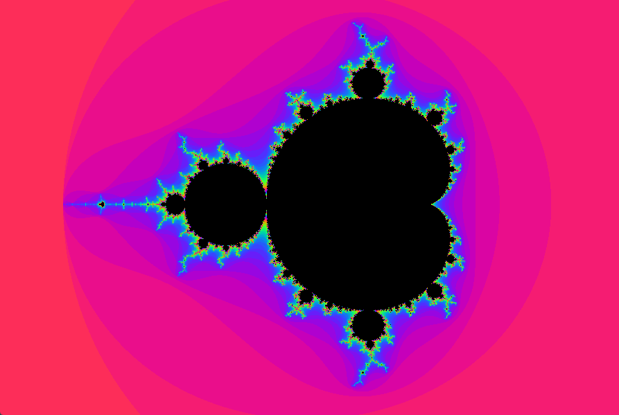
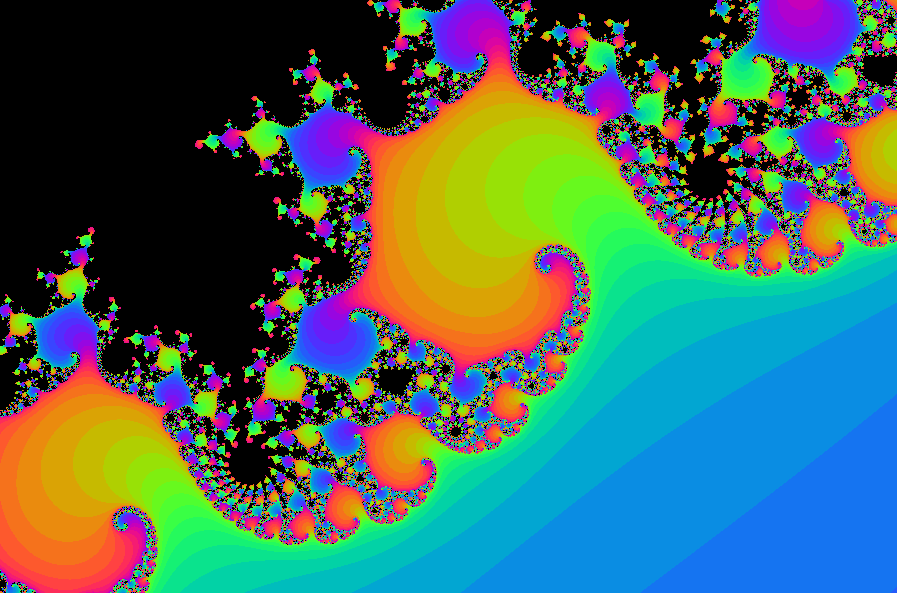
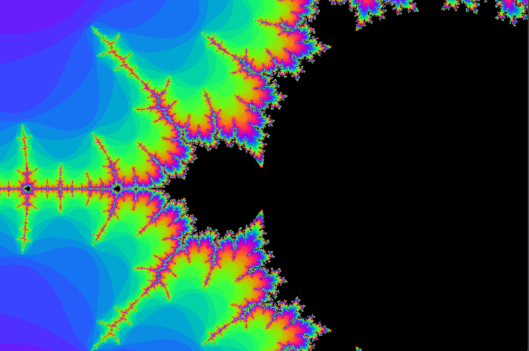
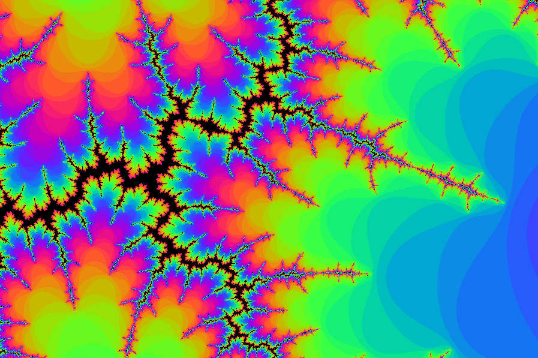
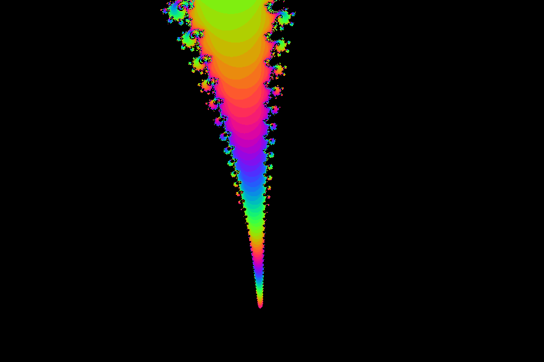
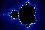
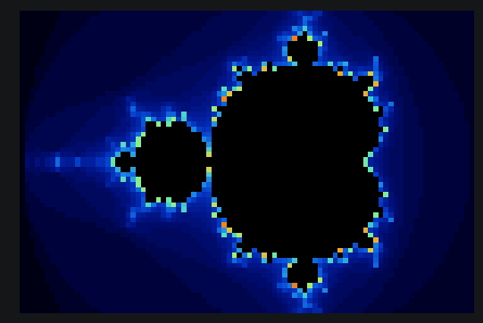
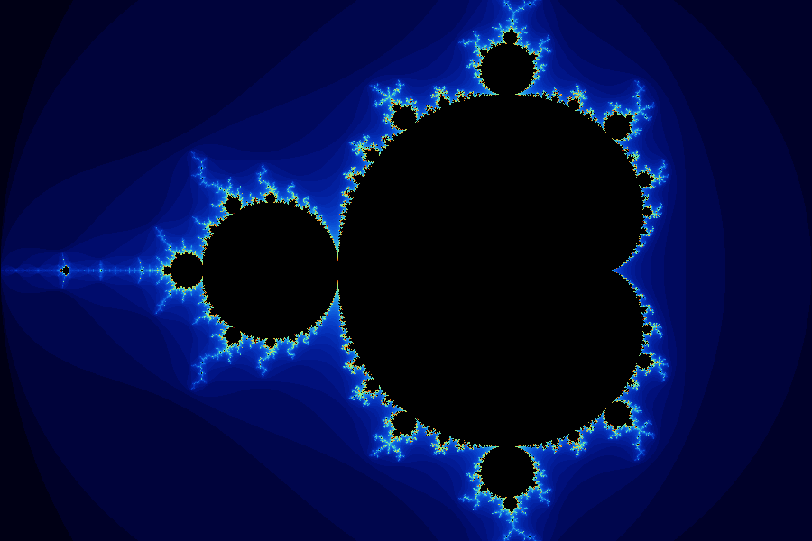
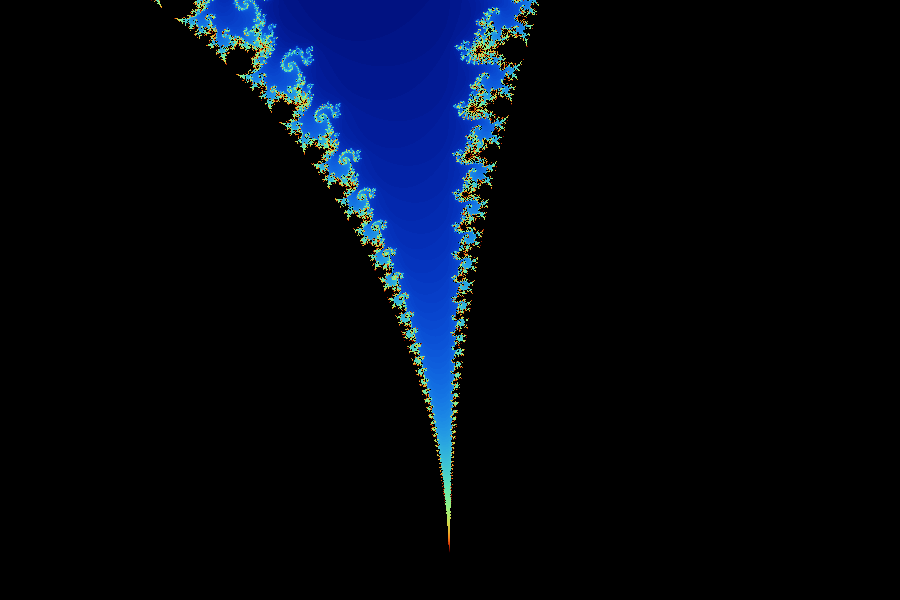
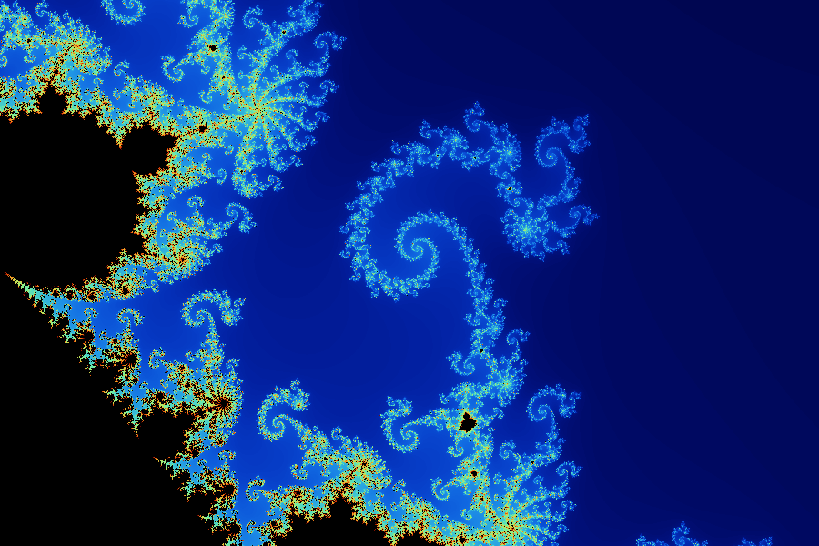

# julia-mandelbrot

A real-time Mandelbrot set explorer written in Julia, rendered with SDL2.
Multithreaded rendering, a periodic color palette, and mouse-targeted zoom
where the iteration count scales with the zoom level.

## Demo

[](https://www.youtube.com/watch?v=4Im9F8wjDCk)

## Run

```bash
julia --project -e 'using Pkg; Pkg.instantiate()'
julia --project -t auto mandelbrot.jl
```

## Controls

| Key | Action |
| --- | --- |
| `W` | Zoom in towards the mouse cursor |
| `S` | Zoom out |
| `Esc` | Quit |

## Gallery











### Early images

The first versions wrote PPM files instead of drawing to a window, and the
palette was a simple blue gradient.










